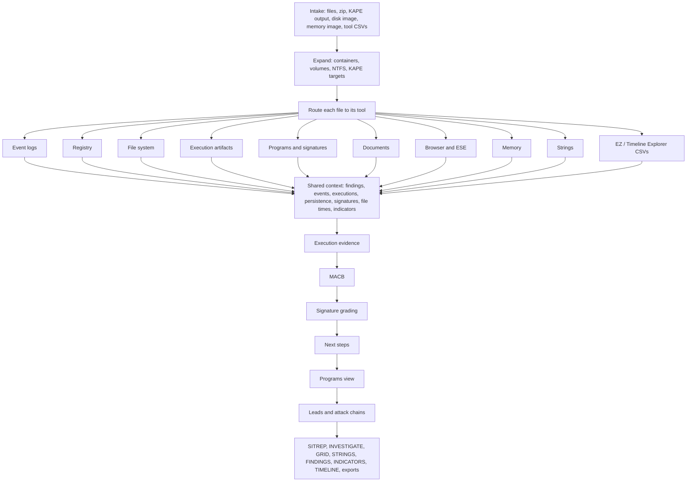

# Sudo-Z workflows, analysis and follow-on triage (v1.9.0)

This page lists everything Sudo-Z does, in the order it does it, and what happens next when a workflow comes back positive. Numbers in brackets point to the code that does the work, listed at the end.

Follow-on triage happens at three levels:

1. **Automatic correlation.** Once every file is parsed, the engine reruns the results through cross-artifact checks: execution corroboration, Programs risk, MACB comparisons, leads and attack chains. A positive in one workflow raises or confirms results in others without anyone asking [1].
2. **Automatic next step text.** Every finding and lead gets a "Next" line chosen by its MITRE technique, then by its category [2]. It tells the analyst what to collect or pivot on.
3. **Analyst pivots.** Any entity (file name, hash, user, IP, path, technique) is one click from INVESTIGATE, which pulls every lead, finding, indicator and timeline event that mentions it [3]. GRID gives the same pivot over any table [4].

What Sudo-Z does not do yet: start new collection on its own when something is positive. For example, a memory injection finding does not dump that process automatically, and a positive disk finding does not queue a Volatility run. The home install runs jobs you start, and auto-loads their results [5].

## 1. Intake

| Input | What happens | Code |
|---|---|---|
| Single files, folders, zips (KAPE, Velociraptor, any layout) | Unpacked in memory, nested zips too; original Windows path recovered from the collection layout | [1] |
| Disk images: raw/dd, split, E01, VHD, VHDX, QCOW2 | Read lazily (never fully loaded), MBR/GPT volumes found, BitLocker detected, NTFS read only, KAPE style targets extracted with their $SI times | [6] |
| Memory images (home install) | Volatility 3 and MemProcFS forensic mode run in the background with 44 plugins (five are Sudo-Z's own), results auto-loaded | [5] |
| Volatility 3 JSON | Parsed in the browser | [7] |
| EZ tool, KAPE module, Autoruns, Sigcheck, Hayabusa CSVs | Recognised by header and graded like the native artifact | [8] |
| Office documents and PDFs | Metadata, macros, links and actions read; also string scanned | [9] |
| Anything else | Hashed (MD5, SHA1, SHA256) and string scanned, listed under REJECTED with the reason | [1] |

**When positive:** nothing to trigger yet. Intake failures (encrypted volumes, unknown formats) are listed so you know what was not looked at.

## 2. Workflows and their follow-on

### 2.1 Event logs (EvtxECmd)

Detects: brute force and password spray (4625, 4776, Kerberos 0x18), Kerberoasting (RC4 4769), AS-REP roasting, pass-the-hash logon patterns, RDP logons (4624 type 10, 1149), explicit credentials (4648), new and changed accounts and groups (4720, 4722, 4724, 4726, 4728, 4732, 4740, 4756), audit policy changes (4719), service installs (7045, 4697), scheduled tasks (4698, 4702, 106, 140, 141, 200), PowerShell script blocks and modules (4103, 4104, 400, 600, 800), process creation with parent checks (4688, Sysmon 1), Sysmon network, file, registry, pipe, DNS and LSASS access events (3, 6, 7, 8, 10, 11, 12 to 14, 15, 17, 18, 22, 25), Defender detections and tampering (1006, 1116 to 1122, 5001, 5007, 5010, 5012), WMI subscriptions (5861), log cleared (1102, 104), missing record numbers and the clock moving backwards [10].

When positive:
* **Automatic:** each process creation feeds the execution list (so Programs and execution evidence see it), each service or task feeds persistence, each remote IP becomes an indicator, and every hit lands on the super timeline. A new account that is then used, or a log that was cleared or has gaps, becomes a lead [11].
* **Next line examples:** a spray asks whether any sprayed account later logged on; Kerberoasting asks you to list the SPN accounts and rotate them; log clearing tells you to lean on Sysmon, Defender, USN, SRUM and $MFT for that window [2].

### 2.2 Registry (RECmd, AppCompatCache, SBECmd, AmcacheParser)

Detects: Run keys and every major autostart (services, Winlogon Shell and Userinit, IFEO debuggers, SilentProcessExit, AppInit_DLLs, COM hijacks, UAC bypass keys, LSA packages), hidden scheduled tasks (SD removed), legacy AT jobs, Defender exclusions and disabled policy, WDigest, RDP settings (enabled, NLA off, odd port, RestrictedAdmin), RID 500 enabled, accounts ending in $, vulnerable or unsigned drivers (BYOVD), remote access and dual use software, Sysinternals EULA keys, user searches and folders with tool names (ShellBags), USB devices, outbound RDP history, netsh port proxies, EnablePrefetcher and NtfsDisableLastAccessUpdate [12].

When positive:
* **Automatic:** ShimCache, Amcache (with SHA1), UserAssist and BAM entries go into the execution list. Persistence entries go into the attack chain builder. Amcache SHA1 values let the leads spot the same file under two names. EnablePrefetcher = 0 changes how missing Prefetch is judged. NtfsDisableLastAccessUpdate sets the MACB Accessed caveat [11, 13, 14].
* **Next line examples:** collect and hash the persistence target and compare its creation time with the first suspicious activity; for a COM hijack, check which process loads the DLL [2].

### 2.3 File system ($MFT, $J, $I30, $Boot, Recycle Bin)

Detects: executables and scripts in suspicious folders, downloads with Mark of the Web, timestomping, ransom notes, mass extension changes, USN renames to one extension, USN deletes (including deleted Prefetch), new executables, $I30 slack entries, recycled files [15].

When positive:
* **Automatic:** downloads open the "Delivered" stage of an attack chain, deletions the "Deleted" stage. A program with execution evidence whose $MFT record is gone becomes the **Executed then deleted** lead. All eight $MFT times feed MACB [11, 16].
* **Next line examples:** for deletion, recover from $MFT, USN names, $I30 slack, $R files and shadow copies; for ransomware, isolate, find patient zero and the encryption start from USN renames [2].

### 2.4 Execution evidence (Prefetch, ShimCache, Amcache, UserAssist, SRUM, BAM)

Detects: LOLBins and admin tools run, files touched from suspicious folders, and coverage checks. These include: ran with no Prefetch file, Prefetch nearly empty, Prefetch disabled, the same path with different SHA1s, present but never proven to run, and artifacts or user hives not collected [13].

When positive:
* **Automatic:** a program seen by several independent artifacts gets a **confirmed by N independent execution artifacts** finding. The Programs view shows a matrix of which artifact saw each program. Execution times set the incident window used by the unflagged new programs lead and the MACB bursts [1, 17].
* **Next line:** confirm run times (Prefetch), the hash (Amcache) and the user (BAM, UserAssist), then read what happened right after on the timeline [2].

### 2.5 Programs and signatures

Every program seen anywhere gets one row: risk score, signer, location class, persistence, findings, and which execution artifacts saw it. Submitted PE files are hashed and their Authenticode signature, signer and compile time are read. Unsigned files, invalid signatures and lookalike names (scvhost.exe, homoglyphs, genuine names in the wrong folder) are flagged [17, 18].

When positive:
* **Automatic:** lookalike hits aggregate into a **Masquerading** lead. Compile time goes to MACB, which skips Microsoft-signed files. The signer feeds the Programs risk score, and an invalid or revoked signature becomes its own finding [11, 16, 17].
* **Next line:** hash, check against threat intel, compare with the genuine Windows file, and review its parent and network activity [2].

### 2.6 Documents (new in 1.9.0)

Detects: VBA macros, remote template injection (T1221), external OLE links and frames, ActiveX, embedded OLE objects, and PDF JavaScript, auto actions, Launch and embedded files. Reads created, saved and printed times, author and last saved by [9].

When positive:
* **Automatic:** template and link URLs become indicators. Document times go to the super timeline and to MACB, where they are compared with the file system [16].
* **Next line:** work out how it arrived (email, download, Zone.Identifier) and who else received it [2].

### 2.7 MACB file times (new in 1.9.0)

Compares the eight $SI and $FN times with each other and with times from inside files and from other artifacts. Checks: $SI born before $FN, B or M after C, four identical whole-second times, born before the volume, future times, born and modified bursts, compiled after B and M, document saved after M or authored after B, shortcut copies later than the current $MFT, and replaced files [16].

When positive:
* **Automatic:** findings carry T1070.006 so the leads treat the file as having evidence removed. A modified burst with one new extension is a ransomware finding (T1486). A born burst inside the attack window is raised to medium [16].
* **Next line:** use $FN times and the USN journal to find the real creation time [2].

### 2.8 Browser and ESE databases (SQLECmd, SrumECmd, WebCache)

Detects: raw IP URLs, file share, tunnelling and offensive tool sites, browser downloads, files opened from suspicious folders, and SRUM network volume per program [19].

When positive:
* **Automatic:** downloads open the Delivered stage; SRUM bytes sent point exfiltration leads at a program; domains and IPs become indicators [11].
* **Next line:** pivot on the destination across hosts and proxy logs [2].

### 2.9 Memory (MemProcFS)

Detects: the 22 FindEvil types, graded and explained, with PROC_NOLINK, PE_INJECT, PEB_MASQ, PE_HDR_SPOOF, PROC_BAD_DTB and AV_DETECT critical; PRIVATE_RWX, NOIMAGE_RWX, PROC_PARENT, PROC_USER, PROC_BASEADDR, UM_APC, THREAD, DRIVER_PATH, PEB_BAD_LDR, PE_NOLINK and PE_PATCHED high; PRIVATE_RX, NOIMAGE_RX, HIGH_ENTROPY and PROC_DEBUG medium; TIME_CHANGE as context. YARA hits are critical. Executable private memory is lowered in just-in-time runtimes [25].

When positive:
* **Automatic:** processes go into the execution list, so they reach Programs and the leads. Services and tasks become persistence, network rows become indicators and timeline events. A process flagged by both MemProcFS and Volatility 3 raises a **critical** correlation finding [25].
* **Next line:** dump the region and confirm the family; for PROC_NOLINK, capture memory before rebooting [2].

### 2.10 Memory (Volatility 3)

Detects: hidden processes (psscan versus pslist, DKOM unlink), name versus command line mismatches, malfind regions named by their opening bytes (Meterpreter and Metasploit stagers, block_api PEB walks, reflective DLLs such as metsrv, erased PE headers, direct syscall stubs), hollowing, process ghosting, PEB masquerading, unbacked threads, direct, indirect and unhooked syscalls, ETW patching, Skeleton Key. LSASS and other key processes are checked for unexpected mapped paths (a MappedPath of N/A where a file is expected). Rootkit checks cover SSDT hooks from both the global table and per-thread KTHREAD tables (Sudo-Z's own plugin), driver and module cross views, callbacks, IRP hooks, timers, orphan kernel threads, the service list cross-view and the device tree. Volatility 2's `apihooks` and `idt` were never ported to Volatility 3, so Sudo-Z ships its own: inline and import table hooks on exported functions, and every processor's Interrupt Descriptor Table. Hidden processes are judged on seven cross-views: Volatility 3's psxview gives four (pslist, psscan, thrdscan, csrss) and Sudo-Z adds PspCidTable, session process lists and desktop threads, with Volatility 2's `-R` rules built in so System, smss.exe, csrss.exe and exited processes are explained rather than flagged. Named pipes are checked against known tool pipes, random names and Potato style impersonation [7, 20, 21, 22].

When positive:
* **Automatic:** when two or more independent plugins flag the same PID, an injection finding is raised to critical: **code injection confirmed by N plugins**. Process and network results feed the execution list, indicators and the timeline, so they join the disk evidence in leads [20].
* **Next line:** dump the process, compare the in-memory image with the file on disk, and capture a full image before rebooting for rootkits [2].
* **Not automatic:** Sudo-Z does not dump the flagged process by itself. Run procdump or `vol windows.memmap --dump --pid N` next.

### 2.11 Strings and grep (bstrings)

Searches every file (and disk image file) with bstrings style patterns: URLs, IPs, emails, paths, registry keys, base64, GUIDs, crypto wallets, hashes, CVEs, JWTs, HTTP requests, user agents, autostart keys, LOLBin command lines, implant strings and keywords. Several patterns can run at once alongside your own regexes, with grep's files-with-matches, count-per-file and invert modes. The home install can run the real bstrings.exe [23].

When positive: hits become indicators. String findings have no time, so the Next line asks you to find the parsed artifact that confirms them [2].

## 3. After parsing: automatic cross-workflow triage

These run once, in this order, on everything the workflows produced [1].

| Step | What it does | Triggered by |
|---|---|---|
| Execution evidence | Coverage table, corroboration and gaps | any execution source |
| MACB | File times compared across every source | $MFT, documents, PE, LNK, zip, images |
| Signature grading | Findings for invalid, revoked or untrusted signatures (expired ones only for drivers) | PE files, Sigcheck, Amcache |
| Next steps | "Next" line on every finding | every finding |
| Programs | One row per program with risk score | any program reference |
| Leads | The chains below | all of the above |

### Leads (the follow-on reasoning)

| Lead | Fires when | Severity |
|---|---|---|
| **Attack chain** | One file name shows up in two or more of Delivered, Executed, Persisted, Network, Deleted across different artifacts | critical when it was delivered or talked to the network and also ran and persisted |
| **Executed then deleted** | Execution evidence for a user folder program whose $MFT record is free or missing | high if the program was already flagged |
| **Renamed binary** | One Amcache SHA1 under several names | high if one name is a LOLBin or known tool |
| **Masquerading** | Lookalike or wrong folder names | critical for non-Latin lookalike characters |
| **Activity window** | Three or more unflagged events within 15 minutes of a high or critical finding | medium |
| **Unflagged new programs** | Programs in user folders that ran within 2 hours of the attack window and nothing flagged | medium |
| **New account used** | A created account that then logs on or uses RDP | high |
| **Log tampering** | Cleared logs, record gaps or the clock moving backwards | high when cleared |

Each lead carries its evidence, entities to pivot on and a Next line [11].

## 4. Views and exports

* **01 SITREP:** severity, attack window, top leads, execution evidence coverage, programs to review, MACB box.
* **02 INVESTIGATE:** every lead, plus a pivot on any value across all results.
* **03 GRID:** a Timeline Explorer style grid over every table: Programs, findings, timeline, indicators, leads, MACB (anomalies, content against the file system, bursts, mactime timeline) and every parsed artifact. It has sort, per column filters, group by, tags, a column chooser, a detail pane and export of the view [4].
* **04 STRINGS, 05 FINDINGS, 06 INDICATORS, 07 TIMELINE, 08 ARTIFACTS, 09 REJECTED, 10 TOOLS.**
* **Exports:** Markdown IOC report, JSON, programs, leads, findings, indicators, timeline and MACB as CSV, and a TSK body file for `mactime` [24].

## 5. Code references

1. `js/engine.js`: intake, routing and the after-parse order
2. `js/ioc/playbook.js`: Next lines by technique and category
3. `js/app.js` INVESTIGATE view and pivots
4. `js/grid.js`
5. `tools/server.py` jobs (vol3, ez, kape, bstrings) and `js/app.js` auto-load
6. `js/image/` (containers, volumes, ntfs, targets)
7. `js/tools/volatility.js`
8. `js/tools/ezcsv.js`
9. `js/tools/documents.js`, `js/parsers/docmeta.js`
10. `js/tools/evtx.js`
11. `js/ioc/leads.js`
12. `js/tools/registry.js`
13. `js/ioc/execution.js`
14. `js/ioc/context.js`
15. `js/tools/artifacts.js`
16. `js/ioc/macb.js`
17. `js/ioc/programs.js`
18. `js/tools/binaries.js`, `js/parsers/pe.js`, `js/ioc/baseline.js`, `js/ioc/heuristics.js`
19. `js/tools/ese.js`, `js/tools/artifacts.js` (SQLite browsers)
20. `js/tools/volinject.js`
21. `js/tools/volrootkit.js`, `js/tools/volatility.js` crossView(), `tools/volplugins/windows/` (kthread_ssdt.py, pspcid.py, sessionprocs.py, idt.py, apihooks.py)
22. `js/ioc/pipes.js`
23. `js/core/bsearch.js`, `js/core/strings.js`, `js/ioc/shellcode.js`
24. `js/report.js`
25. `js/tools/memprocfs.js`, `tools/mpfs_run.py`
